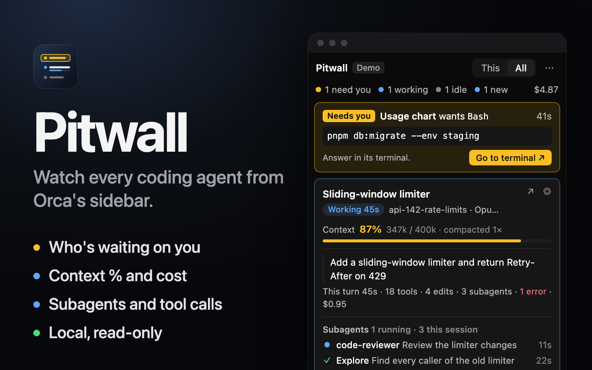
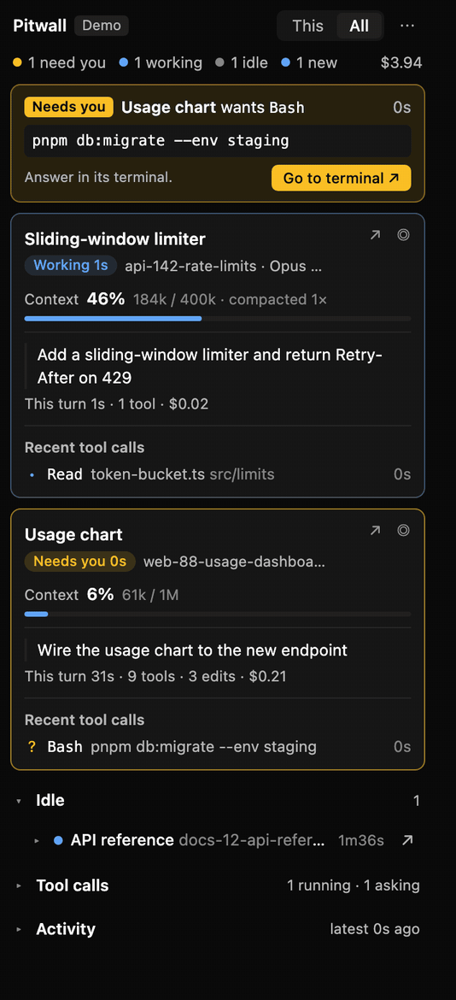

# Pitwall

**A live pit wall for your coding agents, in Orca's right sidebar.**



Every agent you run in an Orca terminal gets a card: what it is doing, how full its context is, what it
costs, which subagents it spawned, and every tool call it makes, as it happens. When an agent stops to ask
you for permission, Pitwall puts it at the top so it never sits waiting unseen.

<p align="center"></p>

Pitwall stays out of your terminal. It lives in the right sidebar, which you toggle with **⌘⌥P**
(Ctrl+Alt+P on Windows and Linux) or by clicking its status bar item.

## What you get

- **Needs-you alerts.** An agent waiting on a permission prompt shows at the top with the exact command it wants to run, and a **Go to terminal** button.
- **New since you looked.** An agent that finishes while you are elsewhere gets a dot, moves to the top of Idle and counts in the header (`1 new`) until you open its row or jump to it. Orca's plugin API does not say which tab you are watching, so an agent finishing in front of you gets the dot too; it clears on your next prompt.
- **Context heads-up.** A working agent past 90% of its context window shows at the top with a hint to `/compact` before it compacts on its own.
- **Jump to any agent.** Click ↗ on any agent to bring its terminal to the front.
- **Details in place.** Click an idle agent's row to open its card right there; ▾ or × closes it.
- **Context bar.** Tokens in context against the window that matters: your auto-compact window when you set one, else the model's. It turns amber at 75% and red at 90%, and counts compactions.
- **Cost and cache.** The API list price of the session's tokens and how much of each prompt came from cache.
- **Subagents.** The running ones and the latest finished, with type, task and time; hover for steps, context and last tools.
- **Background.** What an agent left running or scheduled: background shells and Monitor watches with how long they have run, cron jobs (`CronCreate`) and the `/loop` wakeup with when they run next. An idle agent's row shows the next one (`◷ 14m`) or how many run (`▶ 2`). It lists what is still pending, not a history: a finished shell, a deleted job or a wakeup that ran leaves the list.
- **Tool calls.** The latest calls with their outcome (done, running, asking you, failed, denied) and a count of each. Filter by family: file, shell, web, MCP, agent.
- **Turn receipt.** What the current turn has done so far, and what the last one did: tools, edits, agents, errors, cost, duration.
- **Activity.** Prompts, subagents starting and finishing, edits, failures, denials and compactions.
- **Status bar.** `1 asking · 2 working · 1 bg · ctx 64% · $3.18` at a glance, amber when an agent needs you.
- **This workspace or all.** Follow the workspace you are in, or every agent in every workspace.
- **One agent only.** Click ◎ on an agent to see just its card, tool calls and activity; asks from other agents still show. Show all brings the rest back.
- **Demo mode.** A synthetic session that loops, for trying Pitwall before your agents run (menu ⋯ → Demo mode).

Working agents get a card; idle ones fold into one line each with their context. Every row works from the keyboard (Tab, Enter). Tool calls and activity start folded. The panel uses Orca's theme colours and scrollbars, so it follows light and dark.

## Install

Pitwall needs Orca 1.4.259 or later. Find it in Orca under **Settings → Plugins** (community plugins), or install it
straight from GitHub:

```bash
orca plugin install https://github.com/sonthh/orca-pitwall
```

Orca shows what Pitwall can access and asks you to approve it. Then open the right sidebar and pick **Pitwall**.

## What Pitwall reads, and what it never does

Pitwall reads; the one thing it changes is which terminal is in front, and only when you click.

| Access | Why |
| --- | --- |
| `agent:read` | Which agents run in which terminal, and their state (working, needs you, idle). |
| `workspace:read` | Workspace names, branches and terminal titles, to label each card. |
| `workspace:write` | Only to bring an agent's terminal to the front when you click Go to terminal or an agent row. Pitwall never creates, closes or types into a terminal. |
| `storage:own` | Remembers whether demo mode is on. |
| `settings:own` | Its own settings below. |
| Tool hooks (`agent.tool.before` / `after`) | Sees each tool call as it starts and ends. It always lets the call through unchanged and never makes it wait. |
| Files under `~/.claude` | Claude Code's session transcripts and `settings.json`, for model, tokens, cost, subagents, background work and the auto-compact window. |

It never sends anything over the network, never starts a process, never types into a terminal and never
writes outside its own storage. The one exception is the optional [Crew section](#crew-section-agni-crew), off by default:
while you turn it on, it runs `ssh` to read the Agni crew. The one link out, **★ Star on GitHub**, opens this repository in your browser
only when you click it, after Orca asks. Tokens, keys, passwords and connection strings in tool summaries are masked
before they reach the screen, so a screenshot of Pitwall does not leak them.

## Settings

| Setting | Default | |
| --- | --- | --- |
| Scope | Focused workspace | Or all workspaces. Also the This / All switch in the panel. |
| Show cost | On | Turn off to hide every dollar figure. |
| Context window | Auto | Auto uses your auto-compact window, else the model's. Or force 200k, 400k or 1M. |
| Status bar | On | Show the summary in Orca's status bar. |
| Claude config folder | empty | Where Claude Code keeps its data. Empty means `$CLAUDE_CONFIG_DIR`, else `~/.claude`. |
| Show the Agni crew section | Off | The [Crew section](#crew-section-agni-crew). Also menu ⋯ → Crew. |
| Crew host | `agnx` | SSH alias of the host where `crew` runs. |
| Gateway host | `agni1` | SSH alias of the host where the LiteLLM gateway runs. |

## Crew section (Agni crew)

An optional section for the Agni coding crew, next to your agents. **It is off by default**; nothing below
happens until you turn it on.

**Turn it on:** menu ⋯ → **Crew** in the panel (or the command *Pitwall: Show or hide the Agni crew section*, or
Settings → Plugins → Pitwall → *Show the Agni crew section*). The same item turns it off, which stops every read.

**What it shows**

- **Who is working**, as mascots, the same as `crew watch`: 🐉 Qwen (leader), 🦊 Gemma (second author),
  🐙 Inkling (reviewer), 🦉 Jev (referee), 🎭 Venice (advisor), 🐎 Codex (cavalry) and 🧪 the test runner, each in
  its own colour, **inside each running task's card** (several running tasks: one set each). For each:
  - one line of faces in pipeline order: the ones at work move and say what they do (reading, planning, writing,
    testing, reviewing, thinking); the rest are dimmed faces, without text;
  - a full row only for each seat at work: name, role, how long, its output file and size
    (`leader-build-1.out · 18 kB`, file names only, never code), and its card: name, temperature and VRAM
    (`R9700 57°C 28.7/32 GB`), the temperature amber from 85 °C and red from 95 °C;
  - everyone else folded into one small dimmed row: ✓ or ✕ for a turn had, 💤 for those still to come. A seat gets
    its row when it starts;
  - a 📦 hand-off when work moves from one mascot to the next, 🎉 confetti at merge-ready and 💥 when a task stops
    short (each plays once; a just-ended task keeps its card for ten minutes). Under *prefers-reduced-motion*
    nothing moves, and nothing moves while the panel is hidden or the section is shut or scrolled away.
  A field with no data is left out, never shown as a dash. With nothing running, one line: *Crew asleep*, and the
  last task. Tasks waiting on you still come first. The rows follow the crew's per-seat start and stop lines
  (schema `agni.crew.seat_event/1`, Agni-crew #42) where a crew release writes them, and its stage lines otherwise.
  Any other seat-line schema is ignored.
- **Tasks** from `crew status` on the crew host: id, status (running, waiting, needs_owner, merge_ready, failed,
  interrupted), stage and attempt. A running task is one card: its prompt, its stage timeline (one segment per stage,
  width by seconds), its mascots, and its stages (the run sheet: stage, outcome and seconds, coloured as in the Agni
  Crew Replay), folded while it runs. Other tasks are one line each; click one to open its card.
- **Tasks waiting on you go to the top**, like needs-you alerts: no test command (with the exact
  `crew resume <id> --test-command CMD`), or a task that stopped short (waiting, failed, interrupted) that the
  Codex cavalry could take. Past three, the rest are a count. The status bar adds `crew N for you`.
- **Seats:** Leader Qwen (agnx :28084), Helper Gemma (:28085), Reviewer Inkling (agni2 :8093), each up, down or busy,
  with the seat lock's holder when the lock is deployed. When :8093 does not answer: *agni2 off, agni1-only mode*.
- **Gateway:** spend of `agni-crew-jev`, `agni-crew-claude`, `agni-crew-cavalry` and `agni-crew-frontdoor` against their budgets and the days to expiry, amber at
  80% or 7 days, red at 100% or 1 day (red also goes to the top). This is the alert surface for those keys. A link opens
  the LiteLLM dashboard in your browser.

**How it reads, and what it never does**

- Every 15 s (gateway every 60 s) it runs `ssh -o BatchMode=yes <host> python3 -` with your own SSH config and
  agent, and sends a short read-only script on stdin. Nothing is installed on the hosts and no port is opened.
- On the crew host the script reads `crew status`, the task records under `~/.local/state/agni-crew-three-seat/`,
  the stage lines of `~/.local/state/agni-crew*/events.jsonl` (with a few short words: mode, gate, verdict, test
  exit, and evidence *file names*) and their `agni.crew.seat_event/1` lines, `agni-seat-lock status` and each seat's
  `/health` on loopback. For a seat still running it reads the size of its output file, never its contents. From
  `crew.toml` (and the agni1-only fallback it names) it sends only each seat's name and model name. It sends back
  only the fields above: no prompts, reasons, worktree paths or code.
- The event logs are **tailed**: each run reads only what was appended since the last (Pitwall sends back where it
  stopped), and a new or rotated log is read afresh from its last 2 MB.
- **Card temperature and VRAM**, only while the Crew section is on screen and a task runs, at most every 20 s: the
  same `ssh … python3 -` on the hosts the crew config puts the seats on (agni1 for Qwen and Gemma, agni2 for Inkling;
  agni1 for Inkling too in agni1-only mode). The script runs only the tools already there, `rocm-smi` (agni1) and
  `nvidia-smi` (agni2), and Pitwall parses their output. A host that is off, or a tool that is missing, leaves the
  fields out. Which card serves which model is the one fact Pitwall keeps itself (`MODEL_CARD` in
  `src/worker/crew/gpu.ts`); a model it does not know gets no card.
- On the gateway host the script reads the LiteLLM master key from the gateway's environment file *there*, asks the
  admin API on `127.0.0.1:4000`, and prints only alias, spend, budget and expiry of the two crew keys. The master key
  never leaves that host and is never printed; no key value or hash comes back.
- It never starts, stops or changes a task, a seat or a key. Pitwall stores no crew data.
- When a host does not answer, the section says **crew unreachable** (or gateway unreachable) and when it last
  answered; the rest of Pitwall carries on.

**Install this build (fork branch `feature/agni-crew`)**

```bash
git clone -b feature/agni-crew git@github.com:RedKnight13/orca-pitwall.git && cd orca-pitwall
orca plugin dev load .        # then --approve <fingerprint> as printed
```

Then open Pitwall (⌘⌥P) and choose menu ⋯ → **Crew**. A `dev load` of this folder replaces any other development
folder loaded as `pitwall`.

## Agents

Pitwall reads Claude Code transcripts today. Any other agent Orca knows about still gets a card with its
state and its tool calls; the transcript-based numbers (context, cost, subagents) come as adapters for more
agents are added. The worker keeps agent-specific code in `src/worker/claude/`, so an adapter for another
agent is a sibling folder.

## About the numbers

- **Cost** is what the session's tokens would cost at Anthropic's API list prices, including cache reads and
  5-minute and 1-hour cache writes. On a Pro or Max plan you do not pay this; read it as a size.
  A model Pitwall has no price for shows no cost rather than a wrong one.
- **Context** is the size of the last request: its prompt (input, cache reads and cache writes) plus its output. After a compaction it starts from the compacted size.
  Its percentage is of your auto-compact window when you set one, so it shows how close the next compaction is. Claude
  Code's own status line divides by the model's window, so with a 400k auto-compact window on a 1M model, 212k shows
  as 53% in Pitwall and 21% there. The tooltip names the window used.
- **No partial numbers.** A long transcript takes a few seconds to read after Orca or Pitwall starts. Until it is read to the end, its card says so and shows no context, cost or turn, and the totals wait too.
- **Turns** start at a prompt, or at a slash command the model answers. Commands that run locally (`/model`, `/reload-plugins`) leave the last turn as it was.
- **Background** comes from the transcript too: a shell or monitor is pending from the result that started it until Claude Code reports it finished, failed or stopped (or `TaskStop` ends it); a cron job until `CronDelete`, its one run, or its expiry; the wakeup until it runs, is replaced or is stopped. After a compaction, Claude Code lists the tasks still running and Pitwall drops any shell missing from that list. The next run is the time Claude Code reported, which includes the few minutes it shifts each job by; later runs keep that shift. Claude Code runs schedules only while the agent is idle: past its time while the agent works, a job shows **due**; past its time while the agent has sat idle for 20 minutes, the session is not running it any more and it leaves the list. Shells, the wakeup and cron jobs (unless durable) live in the Claude Code process, so they end when it exits: when the session is resumed, Claude Code reports its shells stopped, and a SessionStart hook, if you have one, tells Pitwall the rest are gone; without one, a schedule leaves the list once the idle rule above applies. Background agents show under Subagents; a subagent's own background shells are not tracked.
- **Format changes.** Claude Code's transcript format is not documented. When a transcript has many rows and none Pitwall understands, its card says so instead of showing zeros.
- **Needs you** comes from Orca: the agent waits on you (Orca reports a permission prompt as waiting) while a tool call is still open; that call is the one it asks about. Once you answer, the transcript tells Pitwall whether you allowed or denied it.

## Develop

```bash
git clone https://github.com/sonthh/orca-pitwall && cd orca-pitwall
npm install                   # TypeScript and Node types, for the type check only
orca plugin types .
npx tsc -p .                  # type check
orca plugin test .            # unit tests, synthetic data only
orca plugin dev load .        # then --approve <fingerprint> as printed
```

There is no build step: Orca runs the TypeScript in `src/` directly. After an edit, run `orca plugin dev load .`
again and approve the new fingerprint. `orca plugin shot <key> --panel pitwall` saves a PNG of the panel.

```
src/
  shared/      snapshot types, panel/worker protocol, formatting
  worker/      Orca events and hooks, tool call tracking, pricing, masking, demo
    claude/    Claude Code transcripts: locate, tail, parse, subagents
  panel/       the sidebar page: pure render functions, styles, bootstrap
test/          builders for synthetic transcript rows
```

## Contributing

Bug reports, ideas and pull requests are welcome: see [CONTRIBUTING.md](CONTRIBUTING.md).

## License

MIT
